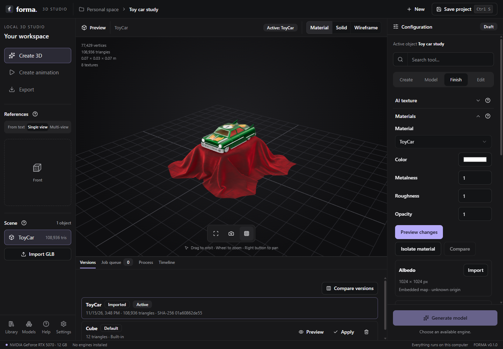

# Forma

A desktop studio for turning text and reference images into **3D assets**, then refining, animating and exporting them for Blender, Unity or Godot.



*Actual application capture with an imported GLB sample; the car is not an AI-generated result.*

[User manual](docs/manual.md) · [Manual en español](docs/manual.es.md) · [Downloads](https://github.com/jscode-es/forma/releases)

## What you can do

- **Start with text or images:** generate reference candidates, enlarge and select one, or import single and multiple views for image-to-3D generation.
- **Refine the mesh:** inspect geometry, reduce triangles, create LODs, retopologize, unwrap UVs and bake normals or ambient occlusion.
- **Finish the surface:** edit materials, generate PBR textures or paint directly on the model.
- **Work with animation:** create a humanoid rig with manual landmarks, edit clips, reuse a clip library or capture motion from video.
- **Review before applying:** results become preview versions, preserving the original for comparison.
- **Export assets:** save GLB files or validated packages with LODs and import instructions for Blender, Unity and Godot.

Forma is under active development. See the [manual](docs/manual.md) for workflow limitations and the [development phases](docs/phases.md) for remaining work.

## Platforms

| Desktop platform | Installer targets | Local CUDA image / 3D engines |
| --- | --- | --- |
| Windows | `.exe` (NSIS) | Compatible NVIDIA GPU and driver required |
| Linux | `.AppImage`, `.deb` | Compatible NVIDIA GPU and driver required |
| macOS | `.dmg`, `.zip` | SDXL and Hunyuan require CUDA; no Metal/MPS backend is provided |

These are configured build targets; available artifacts depend on the release. Desktop support does not mean every engine supports that platform. GPU generation has been exercised on Windows with an RTX 5070; other platform/engine combinations need their own validation.

## Requirements

Importing and inspecting GLB files, editing materials, managing projects and exporting do not require an AI engine. Forma itself does not require an account.

| Workflow | Additional requirements |
| --- | --- |
| SDXL-Lightning reference images | NVIDIA CUDA, **8 GB VRAM**, Python **3.11**; about **10 GB available system RAM** for Qwen3 prompt preparation and **17 GB free disk** installation budget |
| Hunyuan3D 2.0 / 2 MV image to 3D | NVIDIA CUDA, **8 GB VRAM**, Python **3.11**, Git and space for the environment and weights |
| Hunyuan3D Paint 2.1 PBR textures | NVIDIA CUDA, **10 GB VRAM**, Python **3.11**, Git and space for weights |
| Retopology: Instant Meshes + XAtlas | Windows x64, Python **3.11**, CPU; about **0.3 GB disk**, no Blender or GPU required |
| Mesh inspection, standalone UV tools, baking and humanoid rigging | **Blender 4+**; select its executable in Settings if it is not detected |
| MediaPipe Motion capture | Python **3.11**; CPU inference, no CUDA requirement |
| Optional external CLI engines | Selected CLI installed and signed in; its own account, network access and usage limits |
| Development from source | Node.js **20.19+** (**24 recommended**) and npm |

VRAM figures are engine minimums, not a guarantee for every mesh or texture size. The setup assistant checks compatibility and estimates disk usage before installation. Dependencies and model weights can occupy many GB and are downloaded separately from the desktop app.

### Local processing and optional accounts

Local engines process prompts, images and models on your computer. Setup downloads dependencies and verified weights; update checks also use the network. Optional **Codex images** and text-to-motion CLI integrations send the requested input to an external service after explicit consent and may consume account quota. See the [manual](docs/manual.md#create-a-model-from-text).

## Get started

1. Download an available installer from [Releases](https://github.com/jscode-es/forma/releases), or run from source below.
2. Open the setup assistant, review compatible engines and accept the licenses of those you want to activate.
3. Add an image under **References → Single view**, or generate candidates under **From text**.
4. Choose an installed generation engine and click **Generate model**. Review the preview and **Apply** it.
5. Refine the result and open **Export** to save a GLB or prepare an engine package.

Already have a GLB? Use **Import GLB** to start working with it directly.

## Engines and licenses

Activate engines in **Models → Engines**. Forma displays requirements and licenses before preparing the Python environment and downloading pinned, checksummed weights.

| Engine | Purpose | Model license |
| --- | --- | --- |
| [SDXL-Lightning + Qwen3](plugins/sdxl-lightning/README.md) | Prompt preparation and reference images | CreativeML Open RAIL++-M; Qwen3: Apache-2.0 |
| [Hunyuan3D 2.0](plugins/hunyuan3d-2/README.md) | Image to 3D and background removal | Tencent Hunyuan 3D 2.0 Community |
| [Hunyuan3D 2 MV](plugins/hunyuan3d-2-mv/README.md) | Multiple reference views to 3D | Tencent Hunyuan 3D 2.0 Community |
| [Hunyuan3D Paint 2.1 PBR](plugins/hunyuan3d-2-1-paint/README.md) | Albedo, metallic and roughness textures | Tencent Hunyuan 3D 2.1 Community |
| [MediaPipe Motion](plugins/mediapipe-motion/README.md) | Motion from video | Apache-2.0 |
| [Instant Meshes](plugins/instant-meshes/README.md) | CPU quad retopology and XAtlas UVs | BSD-3-Clause; XAtlas: MIT |

**The bundled Hunyuan model licenses exclude the EU, UK and South Korea.** Review each engine license before activation. Forma's MIT license does not replace model licenses.

## Run from source

```bash
git clone https://github.com/jscode-es/forma.git
cd forma
npm install
npm run dev
```

If npm blocks Electron's install script, run `node node_modules/electron/install.js` first.

```bash
npm run typecheck
npm run lint
npm run build
npm start
```

`npm run dist` packages the app for the current OS. The stack is Electron, Next.js static export, Kivora and SQLite (`node:sqlite`).

## Documentation and contributing

- [Illustrated user manual](docs/manual.md) · [Manual ilustrado en español](docs/manual.es.md)
- [Architecture](docs/architecture.md) · [Plugin guide](docs/plugin-guide.md) · [Engine plugins](docs/engine-plugins.md)
- [Command line](docs/cli.md) · [Releasing](docs/releasing.md) · [Development phases](docs/phases.md)
- [Contributing](CONTRIBUTING.md) · [Code of Conduct](CODE_OF_CONDUCT.md)

## License

[MIT](LICENSE). Screenshot sample: [Toy Car](https://github.com/KhronosGroup/glTF-Sample-Assets/tree/8f492390ddc7a2ae221a1369ef560589cf8c70fb/Models/ToyCar), Guido Odendahl and Eric Chadwick, CC0. See [screenshot notes](docs/images/README.md).
