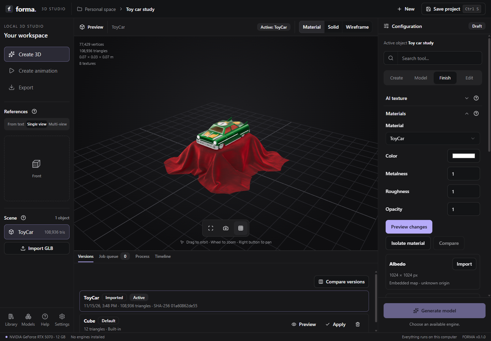
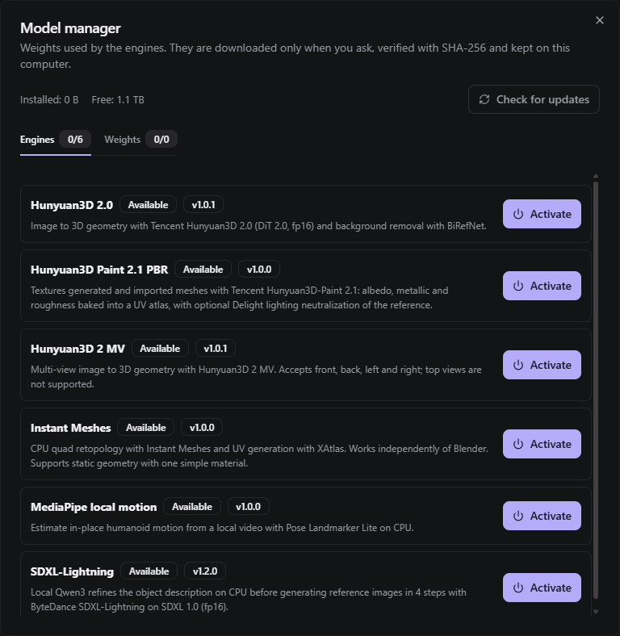
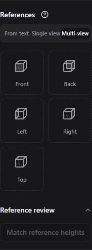
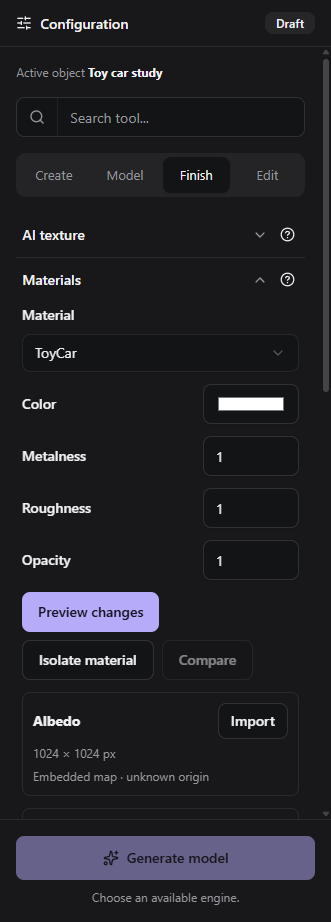
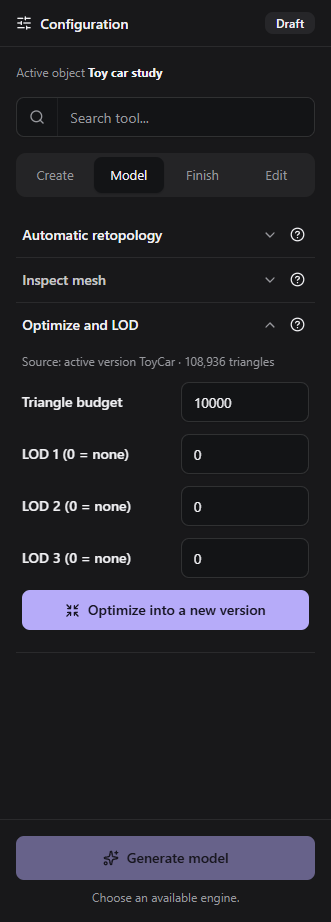
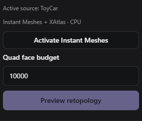
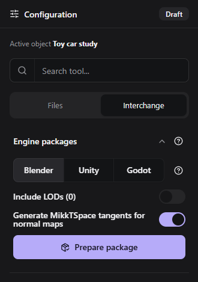
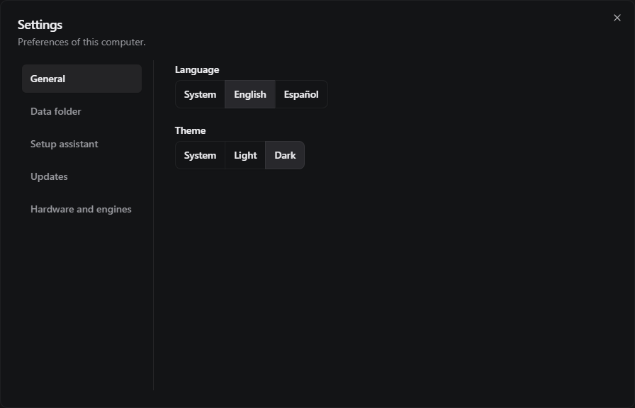

# Forma user manual

[Español](manual.es.md)

Forma turns text and reference images into 3D assets, with tools for mesh editing, materials, animation and export. Local engines keep inference on your computer; optional external CLI engines send the requested input to their service after explicit consent.

## Find your workflow

- [Explore the studio](#the-studio) and [activate an engine](#activate-an-engine).
- Create a model [from an image](#create-a-model-from-an-image) or [from text](#create-a-model-from-text); organize [multiple views](#multiple-views-and-reference-review).
- Review [versions](#versions), edit [materials and textures](#materials-and-textures), or use [mesh tools](#mesh-tools).
- Create a [humanoid skeleton](#humanoid-skeleton) and work with [animation clips](#animation-and-clip-library).
- [Export](#export), manage [projects](#projects) or change [settings](#settings-and-data).

For hardware, platform and installation requirements, see the [README](../README.md#requirements).

## Install

Download the installer for your system from the [releases page](https://github.com/jscode-es/forma/releases): `.exe` for Windows, `.dmg` for macOS (Apple Silicon), `.AppImage` or `.deb` for Linux. Installers are not signed yet, so Windows SmartScreen and macOS Gatekeeper ask for confirmation the first time (on macOS: right click → Open).

## The studio

*Imported Toy Car sample, not an AI-generated model. The captures use the English interface; language can be changed in Settings.*

| Area | What it does |
| --- | --- |
| Top bar | Project name, unsaved indicator (purple dot), New, Save project (Ctrl+S) |
| Left menu | Create 3D, Create animation, Export; References below the main menu with From text, Single view and Multi-view tabs; the scene object; Library, Models, Help and Settings |
| Viewport | The 3D view. Drag to orbit, wheel to zoom, right button to pan. Material, Solid and Wireframe views, camera presets, frame and grid |
| Bottom dock | Versions, Job queue, Process (inputs, parameters, files and log of each job) and Timeline |
| Inspector | Changes with the left menu section. Create 3D: Create, Model, Finish, Edit. Create animation: Capture, Skeleton, Clips, Character. Export: Files, Interchange. Search looks inside the current section; arrow keys move between tabs |
| Status bar | GPU and VRAM, available engines, version |

Every new project starts with a 1 m cube. Projects, settings and the panel layout are remembered; the last project opens on start.

## Activate an engine

Open **Models → Engines** to choose a runtime. Engine installation and model-weight downloads are separate from installing Forma.

The first time Forma opens, the **setup assistant** checks the GPU, VRAM, CUDA, free disk, Python 3.11, Blender and the external CLIs, marks every engine as recommended, optional or not compatible (with the reason), estimates the disk it needs and installs the chosen ones one after another after you accept their licenses. You can close it while it installs, and open it again from **Settings**.

Forma includes the engines it supports, but you activate them yourself because their licenses are between you and their authors.

1. Open **Models** (left menu) → **Engines**.
2. Click **Activate** on the engine (for example Hunyuan3D 2.0). Check the requirements: NVIDIA GPU with CUDA and enough VRAM, Python 3.11, Git when the plugin downloads code, free disk.
3. Read the licenses, tick **I have read and accept these licenses** and click **Accept and activate**.
4. Forma downloads the engine code at a fixed version, prepares its Python environment (several GB the first time), verifies it and downloads the model weights. Progress and the last lines of output are shown; you can cancel.

Advanced: if you already have a Python environment with the required packages, tick **Use an existing Python environment** and choose its `python` executable.

The **Weights** tab lists model files with their size, license, revision and status. Verify recalculates SHA-256 checksums, Repair downloads only the damaged files and Check for updates only reports newer upstream versions.

Hunyuan3D 2.0 is licensed by Tencent and the license does not apply in the European Union, the United Kingdom or South Korea.

## Create a model from an image

1. In **References > Single view**, click the image card or drop an image from a folder onto it. PNG, JPG and WebP are supported (up to 20 MB and 16 megapixels).
2. Optional: right-click the card and choose **Remove background**. **Use the image without background** in that menu chooses which version is used.
3. In **Create 3D → Create → Generation engine**, choose the engine (the gear opens the model manager). Quality (Fast, Balanced, High) sets 15, 30 or 50 steps; its gear customizes the steps of each profile. Engine settings (seed, guidance, resolution) are saved with the project.
4. Optional: **Physical scale** resizes the result to a height in meters.
5. Click **Generate model**. The job appears in **Job queue**; **Process** shows its progress, prepared images and log.

On an RTX 5070 (12 GB), Hunyuan3D 2.0 needs about 2 minutes at 30 steps.

## Create a model from text

1. Activate an image engine, such as **SDXL-Lightning**, in **Models → Engines**.
2. In **References → From text → Prompt**, describe one object and choose the image engine. *Images* sets how many candidates you get and *Seed* makes them reproducible; candidate *n* uses seed + *n*.
3. Click **Generate images** (or press Ctrl+Enter in the prompt). The candidates appear under the prompt.
4. Click the candidate you like: it becomes the reference, with its prompt and seed.
5. Configure the generation engine and click **Generate model**, as in [Create a model from an image](#create-a-model-from-an-image), from step 3.

With **SDXL-Lightning**, local Qwen3 first translates the object request into English and separately extracts a compact list of appearance attributes from the shared style. The requested subject stays first; scenery, props and other subjects from the style are excluded. Both text encoders' token limits are respected. The button shows **Improving prompt…**, generation progress and then **Removing background…**. After releasing SDXL, local BiRefNet creates an RGBA PNG with real alpha. No llama.cpp or Ollama server is needed. The original prompt and full style stay in history; the effective prompt appears in the job log.

Hover a candidate and click **Enlarge candidate** to inspect it in a modal. Closing the modal does not select it; click the candidate card to use it as the reference.

To keep a common look across SDXL generations, click the **gear beside the engine's ?** and enter a **Shared visual style**, for example `low-poly, pastel colors, isometric view, soft lighting`. The expanded field accepts **2000 characters** and displays `current/max`. It is saved automatically on this computer and affects only the requested object's finish, shape language, technique and palette. Leave it empty or use **Clear style** to disable it. Jobs and prompt history retain the style used; reusing an SDXL prompt restores that style too. The style is summarized for the image model, so long texts may lose secondary attributes.

All published generated candidates must be nonempty PNGs with real transparency. Opaque images, entirely transparent images and drawn checkerboards without an alpha mask are rejected. The checkerboard in candidate previews belongs to the viewer and is not saved in the PNG. Codex is instructed to generate transparent PNGs too; a provider result without valid alpha fails instead of being published. This validation does not apply retroactively to images generated earlier or to imported references.

**Codex images (external CLI)** is a second image engine that uses the image generation of your own Codex CLI account (installed and signed in). Turn on **Allow this generation with my external account** for each generation: it uses the network and may consume your quota, and it switches off again after every run. Only the prompt is sent; Codex runs in a read-only sandbox and Forma only accepts the image Codex saves in its own generated images folder. Two candidates took about 50 s. Claude Code does not generate images and Copilot CLI is not supported yet.

**Prompt history** keeps every prompt of the project with its engine settings and seed. **Reuse** puts the prompt and settings back so you can repeat or vary it.

## Multiple views and reference review

The slots identify the intended camera angle. They are empty here: add your own images before running a multi-view engine.

1. Open **References > Multi-view**. The two-column grid reserves an image area for Front, Back, Left, Right and optional Top, each with a face icon. Click a card or drop an image onto it to add or replace that view. Right-click a loaded card to remove its background, choose the prepared image, reassign or remove it. Assigning an occupied view swaps the two images.
2. Remove the background of each image. **Reference review** checks transparent silhouette bounds: a height occupancy difference above 15% or opposite-view aspect ratios differing by more than 25% produce approximate warnings. Opaque backgrounds cannot be reviewed reliably.
3. **Match reference heights** creates prepared 1024 px square images with equal object height, preserving proportions and originals. The common height is reduced when needed to fit wide silhouettes without cropping; Top is excluded. The prepared-image switch restores the original at any time.
4. Activate **Hunyuan3D 2 MV** in Models, then select it under **Create 3D > Create**. It uses one to four named side views; Top is not supported. The inspector lists supported views. Single-image engines use Front, or the first available image. Assignments survive saving and job retry.
5. Under **Create 3D > Edit > Reference projection**, select a reference. A fixed orthographic camera overlays the image on the mesh. Adjust opacity, uniform scale and offsets; Reset alignment restores defaults. **Stop projection** restores orbit controls. Alignment lasts for the current session; it does not change mesh geometry, materials or exports.

The MV plugin is provided with pinned code and checksummed weights. GPU inference for this new wrapper still needs a real-model validation run; the Electron workflow is tested with the demo engine.

## Versions

Every result is a new version. Generated and optimized results open in **Preview**:

- **Compare** shows the active version in the same view.
- **Apply** makes the preview the active version.
- **Discard** deletes an unsaved candidate.

The **Versions** tab lists all versions with origin, triangles, parameters and SHA-256 after saving. You can preview and apply any of them. Importing a GLB (scene block → **Import GLB**) creates an active version directly.

**Compare versions** (top of the **Versions** tab) renders up to six versions with the same four cameras (front, three-quarter, side and back), the same lighting and the same framing, one row per version, next to its engine, triangles, size, materials, file size and main parameters. Each model is fitted to its frame, so compare shapes and detail; the sizes are listed in meters. **Save PNG** exports the sheet through the native dialog. Generate the same reference with several engines or settings to choose the best one.

## Materials and textures

The **?** next to each section opens its explanation. Use **Search tool…** to find a tool within the current workspace section.

In **Create 3D > Finish > Materials**, select a material to inspect its factors and embedded albedo, metallic, roughness, normal and AO maps. Import replaces a map in a new preview version; models need the indicated UV channel. Map origin is shown when known. **Preview changes** edits color, metalness, roughness and opacity. **Isolate material** affects only the viewport; **Compare** switches to the active version. Apply the preview before exporting it.

**Upscale 2×/4×** resamples embedded maps bilinearly with a 4096-pixel limit per side. This is resampling, not AI detail reconstruction. Albedo is interpolated in linear RGB and normal vectors are normalized. Transparent normal, metallic, roughness and AO images cannot be processed safely by this path; use opaque data maps.

**AI texture** selects an installed texture engine and an explicit reference for the active mesh. Its result is a preview with the original source retained, even if you select another model while the job runs. The [Hunyuan3D Paint 2.1 PBR](../plugins/hunyuan3d-2-1-paint/README.md) plugin generates albedo, metallic and roughness, regenerates the UVs and can neutralize the reference lighting with Delight; choose the atlas resolution (512, 1024 or 2048 px) in its settings. Use a reference without background for cleaner textures. On an RTX 5070 (12 GB) a 40,000-face mesh with a 1024 px atlas takes about 3 minutes. Normal and AO maps are not generated by the engine: bake them under **Finish > Normals** and **Finish > Ambient occlusion**, or import them. Material editing and map imports work without an AI engine.

## Optimize and LOD

**Create 3D → Model → Optimize and LOD** reduces the active version to a triangle budget and can create up to three levels of detail. UVs, materials and textures are preserved and every file is verified. If a budget cannot be reached without damaging the mesh, nothing is published. Models with skeletons are not supported yet.

## Mesh tools

Mesh inspection, standalone UV tools and baking require Blender 4 or newer; they were tested with Blender 5.2.1 LTS. If discovery fails, open **Settings → Hardware and engines → Configure Blender** and choose its executable. Retopology uses the separate Instant Meshes engine and does not require Blender.

Under **Create 3D > Model > Inspect mesh**, inspect the active version's vertices, faces, triangles, degenerate faces, open borders, non-manifold edges and components. Open borders also count as non-manifold. Inspection only creates a report.

**Retopology** uses **Instant Meshes** on CPU and **XAtlas** for new UVs. Activate it from **Models → Engines**, or use **Activate Instant Meshes** in the Model tab. Activation prepares Python 3.11 and a verified Windows x64 executable; jobs run offline without Blender or a GPU. Other platforms are currently marked incompatible. The budget is 128–100000 quads; Forma retries lower targets and rejects results exceeding that budget. The exported GLB contains up to twice as many triangles. **Preview retopology** creates a candidate version, preserving the original. One static mesh with a simple material is supported; textures, vertex colors, extensions, rigs and animation are rejected to avoid data loss. Inspect the silhouette and topology before applying it.

Under **Finish > UV**, choose a resolution and select **Preview UVs** to unwrap and pack the islands. **Export UV template** saves a PNG through the native dialog, available for the source version or its result during the session. UV replacement also rejects textured materials, vertex colors and complex nodes.

Under **Finish > Normals**, choose outward recalculation or baking from another detailed version. Baking requires existing UVs on the active version, one target mesh and both versions aligned in the same space. It uses Cycles on CPU and embeds the normal map in the GLB. Cage and ray distances are automatic; inspect the preview, especially around close or concave surfaces.

Under **Finish > Ambient occlusion**, choose the resolution and samples and select **Preview ambient occlusion**. Blender bakes the occlusion of the geometry with Cycles on CPU into the existing UVs and Forma adds it as the occlusion map of the GLB: the mesh, the UVs and the other maps stay byte for byte. It needs one mesh with UVs (unwrap them first if needed); an existing occlusion map is replaced. A 40,000-face textured model takes about 12 s at 1024 px and 64 samples.

Every modification preserves the original and requires **Apply** to activate its result. Modifications reject skins, morph targets and animations. GLB resources must be embedded.

## 3D painting

Under **Create 3D > Finish > Paint 3D**, select a material and choose **Start painting**. The mesh needs UV0. A missing base-color texture becomes a white 1024 or 2048 px map; an existing texture keeps its size and must be at most 2048 px per side.

Paint with the left mouse button on the surface. **Clone** sets its source with Alt+click and copies it when painting elsewhere. **Eyedropper** samples the map color; **Restore** recovers the pixels present when the painting session started, including transparency. Radius is measured in texture pixels. The material's color factor continues to multiply the painted map.

**Undo paint** and **Redo paint** operate per stroke. History is limited to 64 MiB: up to eight strokes at 1024 × 1024 and two at 2048 × 2048. **Pause painting** allows navigation; pending strokes survive switching versions and **Return to paint source** brings them back on their mesh. **Save paint version** creates a preview; apply it before exporting. Saving the project automatically includes pending paint as a variant. Closing or switching projects offers save, discard or cancel when strokes remain unsaved.

Painting edits the UV map within 0–1: a brush can reach adjacent texture islands, and interpolation stops at UV jumps. Materials with extensions, other UV channels, nonidentity texture transforms and compressed textures are unsupported. Geometry and other maps remain unchanged.

## Humanoid skeleton

Under **Create animation > Skeleton**, the tools use installed Blender and the version displayed in the viewer. The model should stand upright with +Y up and +Z forward, in a T or A pose. Select each **Body landmark**, adjust its coordinates and enable **Show body guides** to check placement. X and Z are centered on the model bounding box; Y begins at its base. **Preview humanoid rig** creates 19 bones and calculates Blender automatic heat weights. Weighting failures stop the job; there are no fabricated fallback weights.

Select a bone in the editor. **Show bones** draws the skeleton. Rest-position offsets are fractions of model height; **Preview rest-pose edit** saves a change as a new variant. **Show skin weights** displays the selected bone's influence: blue means zero and red means one. This view temporarily suspends painting and restores its materials when disabled.

**Local pose rotation (degrees)** lets you test deformation. **Reset pose** restores rest. These rotations only affect the viewport; they are not saved or exported as animation.

Clip handling is explicit: **Preserve clips** keeps compatible animations when editing the existing skeleton; **Discard clips explicitly** removes them from the new variant. Replacing an existing skeleton requires discard. The original mesh remains intact, and every result needs **Apply** to become the active version before exporting or saving as active.

This auto-rig uses manual landmarks; it does not infer anatomy or create fingers or IK controls. Unsupported cases fail with a job log: independent multiple skins, morph targets, glTF extensions, external resources, ambiguous joint names or invalid weights. Editing requires identity skinned-mesh and nonjoint ancestor world transforms and matching rest/bind poses. Review the preview deformation before applying the result.

## Animation and clip library

Under **Create animation > Clips**, select **Load displayed rig** to read GLB clips or create a local idle, walk or run cycle. These procedural presets require a compatible Forma humanoid skeleton. The animation library is independent of projects: creating, importing or deleting projects does not delete its clips. Save a clip to the library to reuse it; portable animation JSON files use native import/export dialogs.

The editor provides per-bone translation, rotation and scale tracks. Choose a bone, channel and frame, edit values, then add or update the key. Local rotation is entered in degrees and stored as a normalized quaternion. Interpolation is linear or step per track. FPS converts frames to seconds; changing it changes speed without moving keys. Duration cannot exclude existing keys. Undo/redo retain up to 64 MiB of serialized history. Imported cubic channels are sampled to editable frame keys; unrelated original clips remain unchanged when saving a new clip.

The bottom **Timeline** tab plays, pauses and scrubs frames, with loop and speed controls. **Save animation version** creates a GLB preview containing the clip; apply it before exporting. Project save includes pending animation as a variant. Unsaved changes are protected when closing or switching projects. If another version is displayed, return to the animation source to continue editing.

Under **Retarget**, choose a library clip and assign each source bone to a unique target. Matching names provide a starting point. Parent hierarchy and rest orientations/scales must be compatible; compatible size differences are adjusted. Incomplete or incompatible mappings stop without changing the model.

Under **Capture**, choose a local single-person video and generate motion with **MediaPipe Motion**. Its Pose Landmarker Lite model and runtime were installed with user authorization. Inference runs on CPU without uploading video or downloading during a job. The workflow defaults to up to 10 seconds at 15 FPS. Detected motion is saved in the library and opened in the editor for review and saving as a variant.

Video capture estimates motion in place: it does not recover calibrated root travel, axial twist, fingers, facial motion or reliable floor contact; head and neck keep their rest pose. Keep the full body visible. Occlusion and camera movement can produce errors. Insufficient valid poses fail the job.

**Capture → Motion from text** creates a draft clip for the displayed rig with your own **Codex CLI**, **Claude CLI** or **Copilot CLI** (installed and signed in; Forma never stores keys or installs them). Choose the provider, describe one short action, set 1–10 seconds and tick **Allow this generation with my external account** for each generation: it uses the network and may consume your quota. Only the description and the list of bones with their axes are sent, never the character or its files. The CLI runs without tools (Codex in a read-only sandbox, Claude with `--tools ""` and no MCP, Copilot with every tool denied) and must return a JSON plan of bone rotations, which Forma validates (known bones, integer frames, angles from −180 to 180, up to 256 keys, no extra fields) before building the clip. It is a body draft without root travel, fingers or face: review it in the editor before saving a variant. On an RTX 5070 machine a three-second wave took 24–28 s with Codex and 37 s with Claude.

## Export

**Export** (left menu) **→ Files → Export GLB** always writes the active version (a version in preview is not exported until you apply it). The file is read back and its SHA-256 checked. LODs are exported as separate files.

**Export → Interchange → Engine packages** prepares a folder for **Blender**, **Unity** or **Godot** from the active version:

- `model.glb` and, optionally, its LODs as `lod-N.glb`, each checked with the Khronos glTF Validator; a file with validation errors is not packaged.
- MikkTSpace tangents for primitives with a normal map, so the normal map looks the same in every engine.
- `README.md` with the import steps for that engine, `validation.json` and `forma-package.json` (units, axes and the SHA-256 of every file).
- For Blender, `import_forma.py`, which imports the model and its LODs into a `Forma` collection. Unity needs the glTFast package; Godot 4 imports GLB natively.

**Prepare package** runs in the background and lists the files with their validation; **Export folder…** copies them to a new folder and checks every copy.

## Command line

Generations, textures, engine packages and glTF validation also run from a terminal without opening the window: see [command line](cli.md).

## Projects

- **Save project** (Ctrl+S) asks for a name the first time. Files are copied into the project folder.
- **Library** opens, renames, duplicates and deletes projects.
- Closing the window, starting a new project or opening another one asks whether to save, discard or cancel if there are unsaved changes.

## Settings and data

**Settings** uses a sidebar: **General** (language and theme), **Data folder**, **Setup assistant**, **Updates** and **Hardware and engines**. Select a section to see its controls. The hardware report shows GPU, VRAM, driver, CUDA, free disk, Python and engines; this is also where you configure Blender when automatic detection fails. The data folder holds the database, projects, jobs, engines and model weights.

**Updates**: the installed app checks GitHub releases when it starts (turn it off with **Check for updates when Forma starts**) or when you click **Check now**. It only reports a new version: **Download** and **Restart and install** run when you click them. On macOS, until builds are signed, **Download from GitHub** opens the release page instead.

## Troubleshooting

| Problem | What to do |
| --- | --- |
| An engine shows "Python not found" or activation fails with Git or Python missing | Install Python 3.11 from python.org and Git from git-scm.com, then click Activate again |
| "Not enough VRAM" or "CUDA not available" | The engine needs an NVIDIA GPU with CUDA; check the hardware report in Settings |
| A job failed | Open **Process**: the log shows the engine output. **Retry** runs it again with the same inputs |
| The model could not be loaded | Forma keeps the previous version. GLB files compressed with Draco are not supported yet |
| Something else | [Report a problem](https://github.com/jscode-es/forma/issues/new/choose) with the log from Process |
